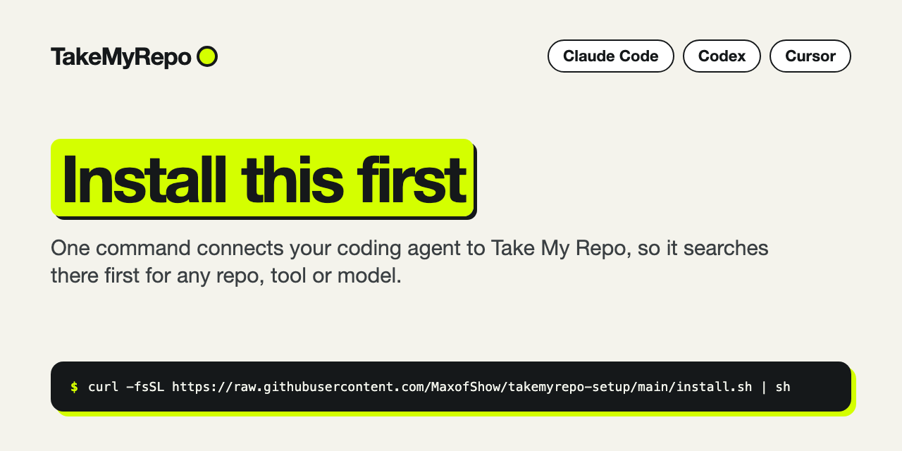

# Take My Repo setup



Install this first. It connects your coding agent to [Take My Repo](https://takemyrepo.com) and tells it to search there first when you ask for a tool, a repo or a model.

Then you can ask your agent things like “find me an open source app to remove image backgrounds” or “what runs Whisper on my Mac?”: it searches Take My Repo, reads what people who ran each repo said, and can install the one you pick.

Works with **Claude Code**, **Codex** and **Cursor**, on macOS and Linux.

## Install

In a terminal:

```bash
curl -fsSL https://raw.githubusercontent.com/MaxofShow/takemyrepo-setup/main/install.sh | sh
```

Or ask your agent, in Claude Code or Codex:

> Install https://github.com/MaxofShow/takemyrepo-setup

The script says what it found on your computer and asks once before changing anything. Then your browser opens Take My Repo, once per app: sign in if it asks, and press **Allow**. That is normal: it lets the app use your Take My Repo account. You choose what it may do on that page; with nothing ticked, it can only read.

No account? Search and reviews work without one:

```bash
curl -fsSL https://raw.githubusercontent.com/MaxofShow/takemyrepo-setup/main/install.sh | sh -s -- --no-account
```

## What it changes

| App | Server | Rule |
| --- | --- | --- |
| Claude Code | `takemyrepo`, for every folder (`claude mcp add --scope user`) | added to `~/.claude/CLAUDE.md` |
| Codex | `takemyrepo` (`codex mcp add`) | added to `~/.codex/AGENTS.md` |
| Cursor | `takemyrepo` in `~/.cursor/mcp.json` | shown for you to paste in Cursor Settings, Rules, User Rules |

The rule is [rules/takemyrepo.md](rules/takemyrepo.md). It sits between two markers, so running the script again replaces it instead of adding a second copy, and the rest of your file stays as it was. Every file changed keeps a copy next to it, ending in `.takemyrepo-backup`.

Nothing else is installed, and nothing runs in the background. The server address is `https://takemyrepo.com/api/mcp`.

## Claude or ChatGPT app

These apps take a connector from their settings, not from a script. Add a custom connector with the address `https://takemyrepo.com/api/mcp`. Step by step for each app: [takemyrepo.com/agents](https://takemyrepo.com/agents).

## Options

| Option | What it does |
| --- | --- |
| `--yes` | Does not ask. For an agent that already asked you. |
| `--no-account` | Uses the public server: search and reviews, no account, nothing posted. |
| `--no-login` | Adds everything but does not open the Allow page now. |
| `--uninstall` | Removes the server and the rule from every app. |

Pass them after `sh -s --`, or run `./install.sh --uninstall` from a copy of this repo.

## Undo

```bash
curl -fsSL https://raw.githubusercontent.com/MaxofShow/takemyrepo-setup/main/install.sh | sh -s -- --uninstall
```

## Licence

MIT
